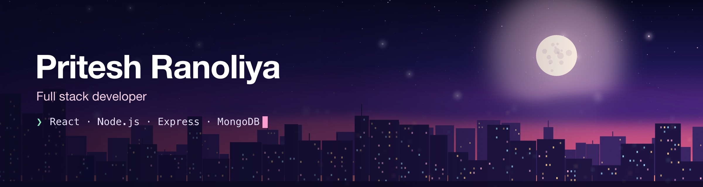
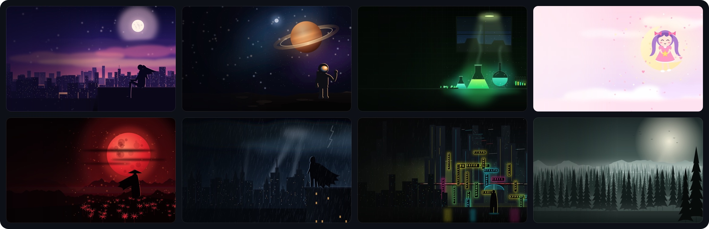

  

I build web apps with React, Node.js, Express and MongoDB, and I'm based in India.

**Currently:** deeper into MongoDB aggregations, GSAP animation and backend performance. 
**Open to:** creative web products, animation-rich React work, hackathons and freelance.

### Projects

**[ThemeFlux](https://github.com/priteshranoliya/themeflux)**: one-click themes for the [cmux](https://cmux.com) terminal on macOS. Eight original illustrated scenes, applied safely with backups and a one-click restore.

### Contact

[Email](mailto:connect.priteshranoliya@gmail.com) · [LinkedIn](https://linkedin.com/in/pritesh-ranoliya) · [LeetCode](https://leetcode.com/priteshranoliya) · [Codeforces](https://codeforces.com/profile/pritesh_ranoliya)
